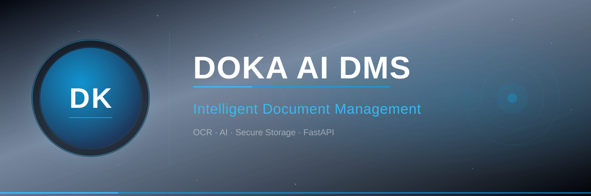

  

  
  
  
  
  
  
  

---

  <strong>A safety-first document management system with AI-powered OCR, classification, semantic search, and Telegram integration.</strong>

  OCR · classification · semantic search · secure storage

---

  
  &nbsp;
  

