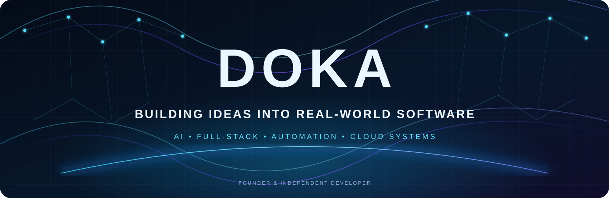

<!-- Profile banner -->

  

<h1 align="center">Hi, I'm Doka 👋</h1>

  <strong>Founder &amp; Independent Developer</strong> 
  Building practical software, intelligent workflows, and dependable cloud systems.

  
  

---

## About

I'm an independent developer focused on turning ideas into useful, maintainable products. My work spans **AI-powered applications, full-stack engineering, document intelligence, automation, APIs, and cloud infrastructure**.

I care about clear architecture, security-conscious engineering, reliable integrations, and shipping software that solves real problems.

## What I'm building

<table>
  <tr>
    <td width="50%">
      <h3>📄 Doka AI DMS</h3>
      A safety-first document management and knowledge platform, bringing together document workflows, OCR, structured data, search, and connected services.
        
      <a href="https://github.com/dokaaidms/doka-ai-dms"><strong>Explore the project →</strong></a>
    </td>
    <td width="50%">
      <h3>⚙️ Automation & Integrations</h3>
      Practical workflows that connect APIs, backend services, messaging, and cloud platforms—with attention to observability and operational safety.
    </td>
  </tr>
</table>

## Technology

  

  
  
  
  

## GitHub at a glance

  
  

  

## Principles

- **Build for people:** solve the actual problem before adding complexity.
- **Engineer with care:** prefer secure defaults, clear boundaries, and maintainable systems.
- **Keep learning:** iterate, measure, and improve continuously.

---

  <strong>Building ideas into real-world software.</strong> 
  Thanks for stopping by — feel free to explore my work and connect through GitHub.

